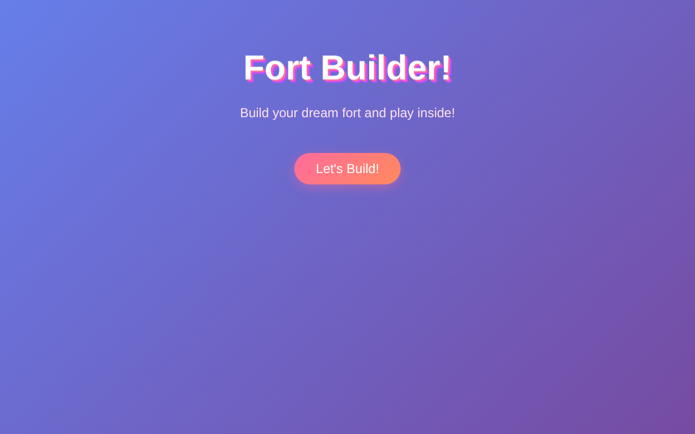
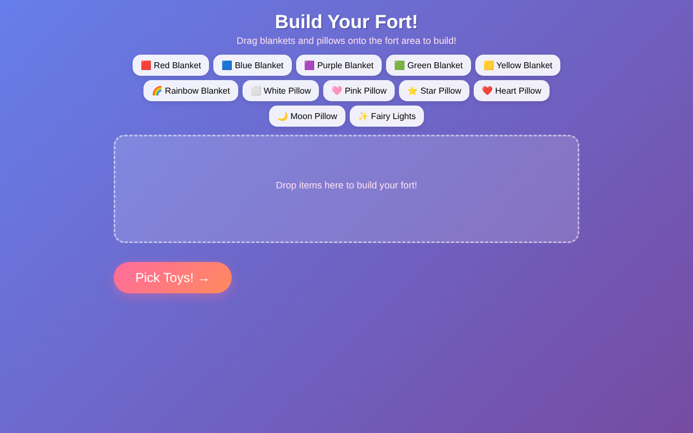

<h1 align="center">Fort Builder</h1>
<p align="center"><b>Build your dream blanket fort and play inside it. A tiny, kid-friendly drag-and-drop browser game.</b></p>
<p align="center">


</p>

<p align="center">


</p>

Fort Builder is a playful drag-and-drop game. Drag colorful blankets and pillows onto the fort area to construct your very own fort, pick your toys, then play inside.

## Features

- **Blankets:** red, blue, purple, green, yellow and rainbow.
- **Pillows:** white, pink, star, heart and moon.
- **Extras:** fairy lights.
- **Multi-step play:** build the fort, then choose toys to bring inside.
- **No install:** plain HTML, CSS and JavaScript. Open `index.html` and play.

## Play

```sh
git clone https://github.com/Ethan-da-Tech-Wizard/fortz.git
cd fortz
open index.html   # or double-click it
```

## Project layout

| Path | Purpose |
|---|---|
| `index.html` | Game page |
| `style.css` | Styling |
| `game.js` | Drag-and-drop game logic |
| `docs/` | Screenshots |

## License

Released under the [MIT License](LICENSE).
